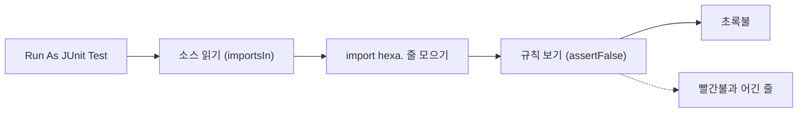

# dependency-check 흐름

- 규칙 셋은 domain, application, adapter/in과 adapter/out 폴더를 읽는다
- domain은 application과 adapter를, application은 adapter를 import하면 빨간불이다
- adapter/in과 adapter/out이 서로 import하면 빨간불이다
- 테스트는 소스 파일을 읽으므로 다시 컴파일하지 않아도 바뀐 import를 본다
