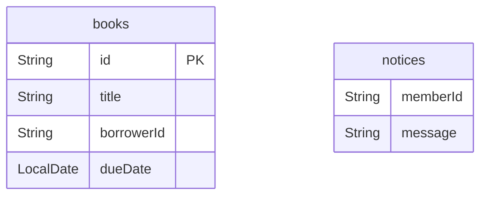

# overdue-notice ERD

- 저장 파일 data/books.txt의 한 줄이 책 하나다
- 알림 파일 data/notices.txt의 한 줄이 보낸 알림 하나다
- notices 칸은 쉼표로 나눈 memberId, message 순서다. 보낼 때마다 끝에 더한다

이 장에서 생기거나 바뀐 것
- notices 파일이 생겼다. Main이 FileNotifyAdapter를 끼울 때만 쓴다
