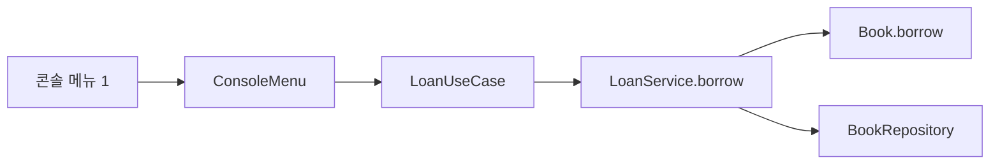
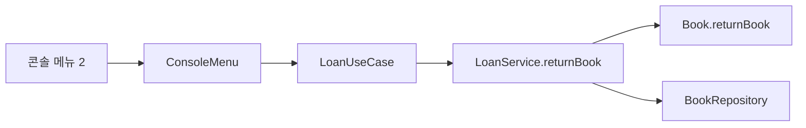
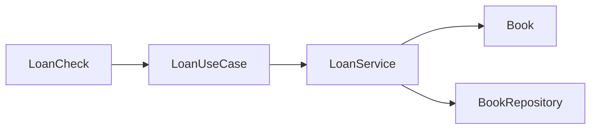

# 시나리오별 구조도

## 책 대출

만든 장: project-setup, layered-loan, use-case-port
맡는 파일
- hexa/src/hexa/Main.java
- hexa/src/hexa/ConsoleMenu.java
- hexa/src/hexa/LoanUseCase.java
- hexa/src/hexa/LoanService.java
- hexa/src/hexa/Book.java
- hexa/src/hexa/BookRepository.java

## 책 반납

만든 장: layered-loan, use-case-port
맡는 파일
- hexa/src/hexa/ConsoleMenu.java
- hexa/src/hexa/LoanUseCase.java
- hexa/src/hexa/LoanService.java
- hexa/src/hexa/Book.java
- hexa/src/hexa/BookRepository.java

## 두 번째 입구로 대출과 반납

만든 장: use-case-port
맡는 파일
- hexa/src/hexa/LoanCheck.java
- hexa/src/hexa/LoanUseCase.java
- hexa/src/hexa/LoanService.java
