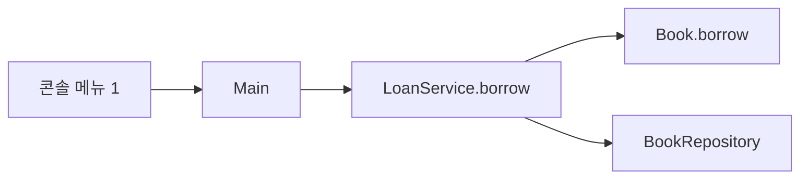
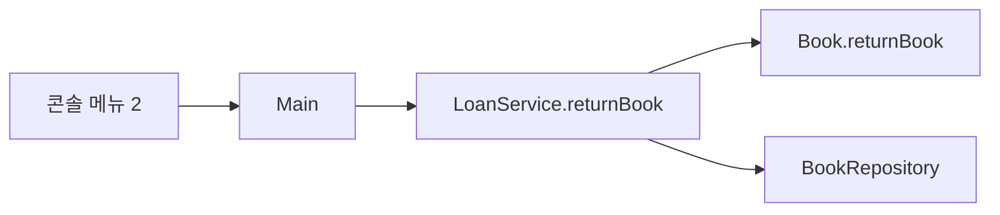

# 시나리오별 구조도

## 책 대출

만든 장: project-setup, layered-loan
맡는 파일
- hexa/src/hexa/Main.java
- hexa/src/hexa/LoanService.java
- hexa/src/hexa/Book.java
- hexa/src/hexa/BookRepository.java

## 책 반납

만든 장: layered-loan
맡는 파일
- hexa/src/hexa/Main.java
- hexa/src/hexa/LoanService.java
- hexa/src/hexa/Book.java
- hexa/src/hexa/BookRepository.java
