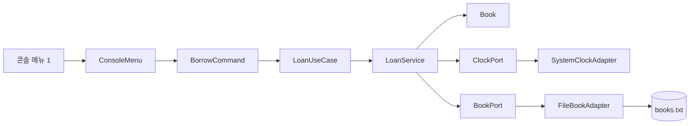
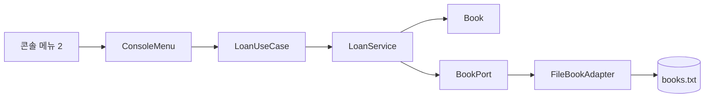
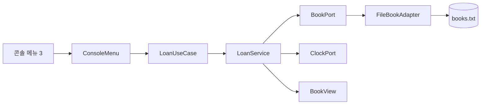
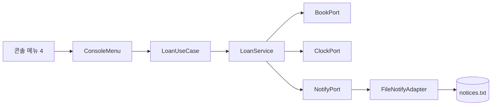
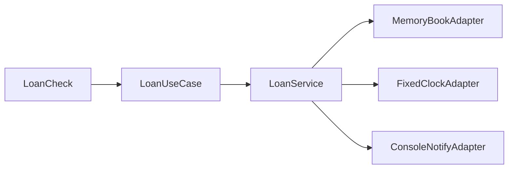
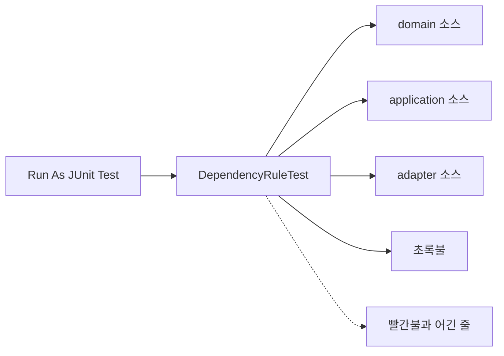

# 시나리오별 구조도

## 책 대출

만든 장: project-setup, layered-loan, use-case-port, store-port, hexagon-packages, file-store, book-list, borrow-command, loan-errors, due-date
맡는 파일
- hexa/src/hexa/Main.java
- hexa/src/hexa/adapter/in/ConsoleMenu.java
- hexa/src/hexa/application/port/in/BorrowCommand.java
- hexa/src/hexa/application/port/in/LoanUseCase.java
- hexa/src/hexa/application/port/in/BookView.java
- hexa/src/hexa/application/LoanService.java
- hexa/src/hexa/domain/Book.java
- hexa/src/hexa/application/port/out/ClockPort.java
- hexa/src/hexa/adapter/out/SystemClockAdapter.java
- hexa/src/hexa/application/port/out/BookPort.java
- hexa/src/hexa/adapter/out/FileBookAdapter.java

## 책 반납

만든 장: layered-loan, use-case-port, store-port, hexagon-packages, file-store, book-list, loan-errors, due-date
맡는 파일
- hexa/src/hexa/adapter/in/ConsoleMenu.java
- hexa/src/hexa/application/port/in/LoanUseCase.java
- hexa/src/hexa/application/LoanService.java
- hexa/src/hexa/domain/Book.java
- hexa/src/hexa/application/port/out/BookPort.java
- hexa/src/hexa/adapter/out/FileBookAdapter.java

## 책 목록 보기

만든 장: book-list, due-date
맡는 파일
- hexa/src/hexa/adapter/in/ConsoleMenu.java
- hexa/src/hexa/application/port/in/LoanUseCase.java
- hexa/src/hexa/application/port/in/BookView.java
- hexa/src/hexa/application/LoanService.java
- hexa/src/hexa/application/port/out/BookPort.java
- hexa/src/hexa/adapter/out/FileBookAdapter.java
- hexa/src/hexa/application/port/out/ClockPort.java

## 연체 알림

만든 장: due-date, overdue-notice
맡는 파일
- hexa/src/hexa/Main.java
- hexa/src/hexa/adapter/in/ConsoleMenu.java
- hexa/src/hexa/application/port/in/LoanUseCase.java
- hexa/src/hexa/application/LoanService.java
- hexa/src/hexa/domain/Book.java
- hexa/src/hexa/application/port/out/NotifyPort.java
- hexa/src/hexa/adapter/out/FileNotifyAdapter.java

## 두 번째 입구로 대출, 연체, 알림, 반납

만든 장: use-case-port, store-port, hexagon-packages, book-list, borrow-command, due-date, overdue-notice
맡는 파일
- hexa/src/hexa/LoanCheck.java
- hexa/src/hexa/adapter/out/MemoryBookAdapter.java
- hexa/src/hexa/adapter/out/FixedClockAdapter.java
- hexa/src/hexa/adapter/out/ConsoleNotifyAdapter.java

## 의존 방향 검사

만든 장: dependency-check
맡는 파일
- hexa/test/hexa/DependencyRuleTest.java
- hexa/lib/junit-platform-console-standalone.jar
- hexa/.classpath
